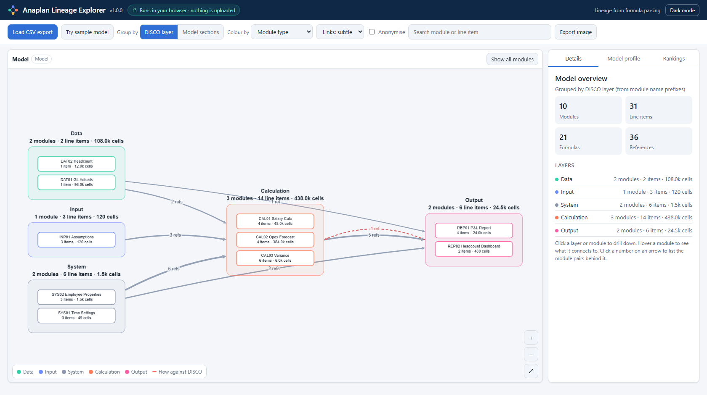
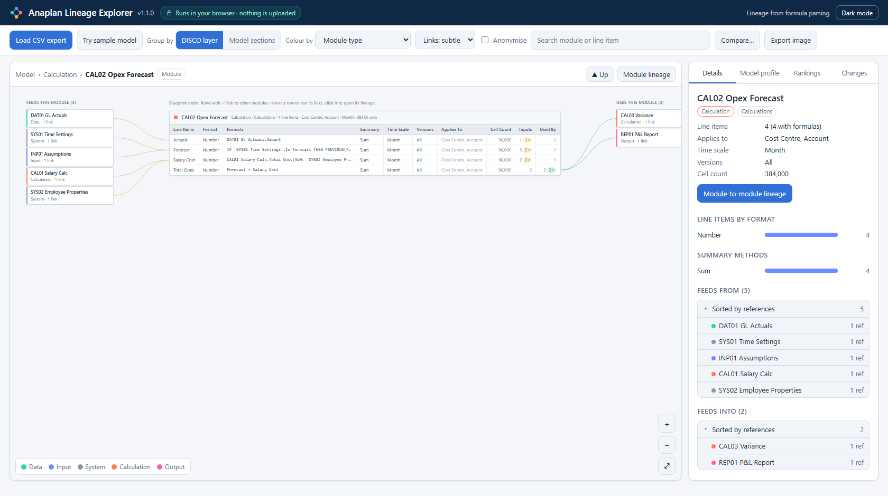
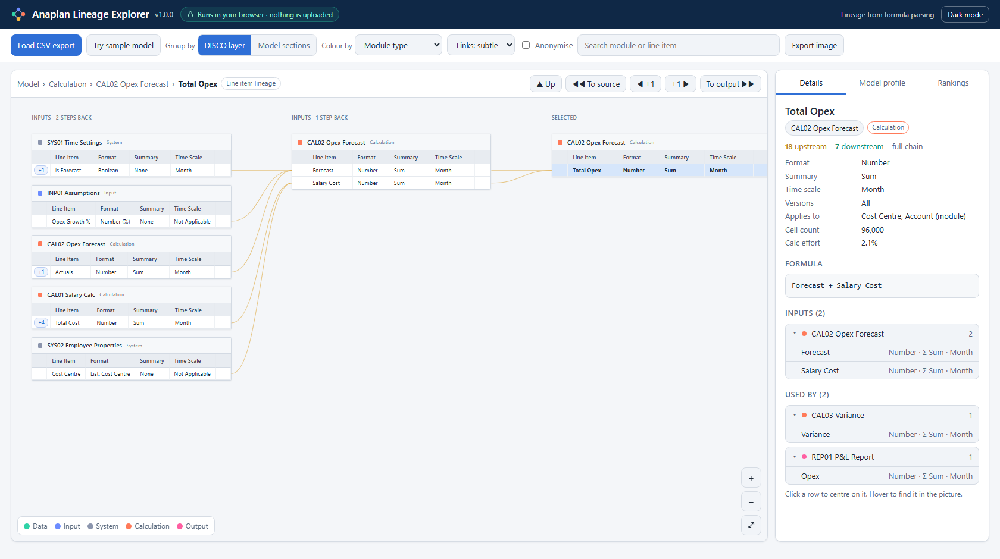
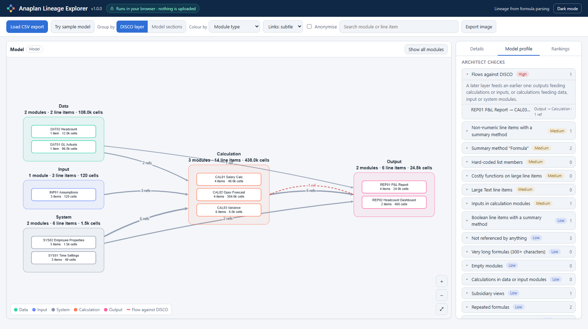
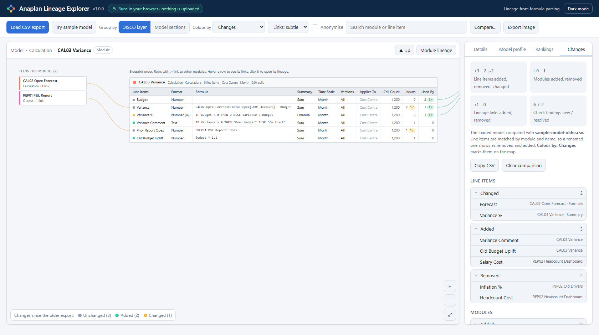

# Anaplan Lineage Explorer

An interactive, browser-only lineage map for Anaplan models, built the way a solution architect reads a model: start from a bird's-eye view, drill into a layer or section, then a module, then a line item, and trace its lineage all the way to the sources and outputs.

**Open the app:** https://karankochhar123.github.io/anaplan-lineage/

No model to hand? Click **Try sample model** in the app, or download [`examples/sample-model.csv`](examples/sample-model.csv), a small made-up model.



## Your data stays on your device

- The whole app is a single `index.html` file. All parsing and drawing happen in your browser.
- Nothing is uploaded. The page's Content Security Policy sets `connect-src 'none'`, which blocks the page's scripts from making network requests (fetch, XHR, WebSocket).
- The only thing loaded from the internet is the open-source Cytoscape.js library (pinned version, from jsDelivr). It has a Subresource Integrity hash, so the browser refuses to run it if the file on the CDN has been changed. Your file is never sent anywhere.
- You don't need an Anaplan login or API access.

## Four levels: drill down and up

| Level | What you see |
|---|---|
| 1. Model | DISCO lanes (Data, Input and System → Calculation → Output) or your model sections. Each lane shows its most-connected modules, and arrows show reference volume between lanes. Flows against DISCO are shown in red. Use **Show all modules** for the full grid. |
| 2. Layer or section | Every module in the lane, with the modules that feed it on the left and the modules it feeds on the right. |
| 3. Module | The module as an Anaplan-style **blueprint grid**: Line Items, Format, Formula, Summary, Time Scale, Versions, Applies To, Cell Count, Inputs and Used By, in blueprint order with Parent indentation and heading styles. The modules that feed it sit on the left and the modules that use it on the right, wired to the exact rows. |
| 4. Line item lineage | Columns of mini blueprints: inputs on the left and items that use it on the right, grouped by module, with row-to-row links. Expand with **+N**, **◀ +1 / +1 ▶**, or go all the way with **To source** and **To output**. |

A breadcrumb (Model › Layer › Module › Line item) and **▲ Up** (or Backspace) move you between levels. **Module lineage** shows the module-to-module chain.





## Look and feel

The app uses a light theme close to Anaplan's own interface by default, with a navy top bar and blueprint-style grids. Use the **Dark mode** button in the top bar to switch. Your choice is remembered in this browser.

## Anaplan metadata

- **Every card shows** format, summary method and time scale. The side panel lists all properties: format details, summary and time summary, time scale and range, versions, Applies To, cell count, calculation effort, parent, style, code, data tags and access drivers (DCA).
- **Colour by** format, summary method, time scale, versions, calculation effort, cell count or formula length. Click a legend entry to show only that value.
- **Model profile** gives breakdowns plus architect checks, ordered by severity. Click any finding to open its lineage.
  - **DISCO structure:** flows against DISCO, inputs in calculation modules, calculations in data or input modules, and subsidiary views (line items whose Applies To or time scale differs from their module's).
  - **Formulas:** hard-coded list members (`SELECT:` or `ITEM(…) = List.Item`), hard-coded numbers, the same formula repeated on the same inputs, deeply nested IFs (4 or more) and very long formulas.
  - **Performance:** costly functions (FINDITEM, RANK, ISFIRSTOCCURRENCE, POST, text functions) and Text format on line items over 1 million cells, Formula summaries, and the highest calculation effort and largest cell counts.
  - **Tidying:** non-numeric and Boolean line items with a summary method, unreferenced line items and empty modules.
  - With **Anonymise** on, findings that quote a formula show `•••` instead.
- **Rankings** list the most referenced line items, cross-module use, downstream impact, calculation effort, cell count and more, and copy as CSV.

## Grouping

- **DISCO layer** is inferred from module name prefixes: SYS/MAP → System, DAT/STG/IMP → Data, INP → Input, CAL → Calculation, OUT/REP/EXP/DSH → Output.
- **Model sections** come from divider modules such as `--- REPORTING ---`. Your export needs the module rows for these (the full Line Items export includes them).



## Compare two exports

See what changed between two versions of a model, for example before and after a sprint or a release.

1. Load the **newer** export as usual.
2. Click **Compare…** and choose an **older** export of the same model.

The **Changes** tab then lists:

- line items and modules added, removed or changed. For a changed line item it shows which of formula, format, summary, Applies To, time scale, versions and access drivers changed, with old and new values in the line item panel.
- lineage links added or removed between line items that exist in both exports
- architect check findings that are new, or resolved on line items that still exist
- modules and line items whose cell count moved by 10% or more

**Colour by → Changes** marks added and changed line items on the map and blueprints, and **Copy CSV** copies every change. Line items are matched by module and line item name, because exports carry no IDs, so a renamed line item shows as one removal and one addition. A field is only compared when both exports have its column.

To try it, load [`examples/sample-model.csv`](examples/sample-model.csv) and compare it with [`examples/sample-model-older.csv`](examples/sample-model-older.csv), a made-up earlier version.



## Sharing screenshots safely

Tick **Anonymise** before you take a screenshot or export an image. Module, line item and section names become neutral labels (for example `CAL001`, `Line item 3.2`, `Section 1`). List, version and time range names become `List 1`, `Version 1` and `Time range 1`. Formulas, notes, codes and data tags are hidden. The same list keeps the same label everywhere, so the model's structure still reads correctly. Untick it to see the real names again.

## How to export from Anaplan

1. In your model, open **Modules** and go to the **Line Items** tab.
2. Select all rows and choose **Export** → **CSV**, including all columns.
3. Drag the CSV onto the app, or click **Load CSV export**.

**Lineage source.** When the export includes the **Referenced By** column, the app uses Anaplan's own references, plus links from dynamic cell access drivers. Without it, the app reads the formulas instead. You can load several exports at once, with and without the column: each file uses its own Referenced By where it has one, and formula reading covers the rest. Formula reading matched about 97% of Anaplan's references on a real model; the rest come from cases such as COLLECT().

## Run it locally

Download `index.html` and open it in Chrome, Edge, Safari or Firefox. It needs internet access the first time so it can load Cytoscape.js.

## Tests

The parsing code is tested with Node's built-in test runner (Node 22 or later, no packages to install):

```
npm test
```

The tests read the code straight out of `index.html`, so there is nothing to build. They run on every push and pull request through GitHub Actions. All test data is made up.

## Changes

See [CHANGELOG.md](CHANGELOG.md) for what changed in each release.

## Feedback

Please open an issue with any problems or ideas. Please don't attach real model data; a header row or a small made-up example is enough.
